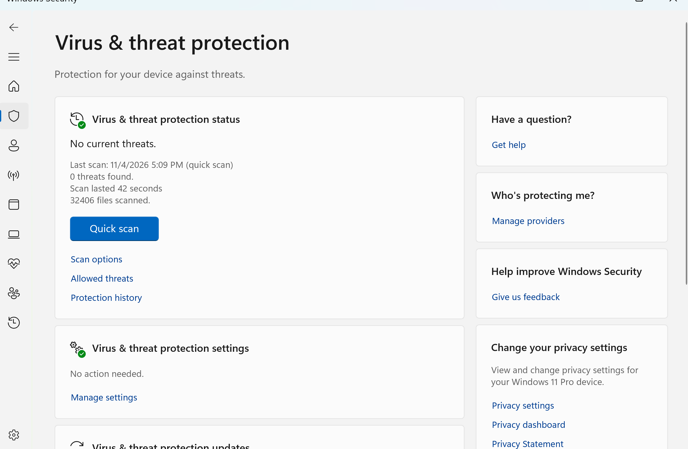
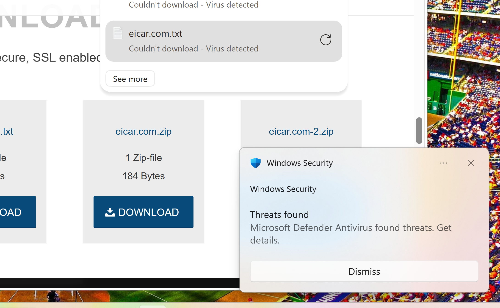
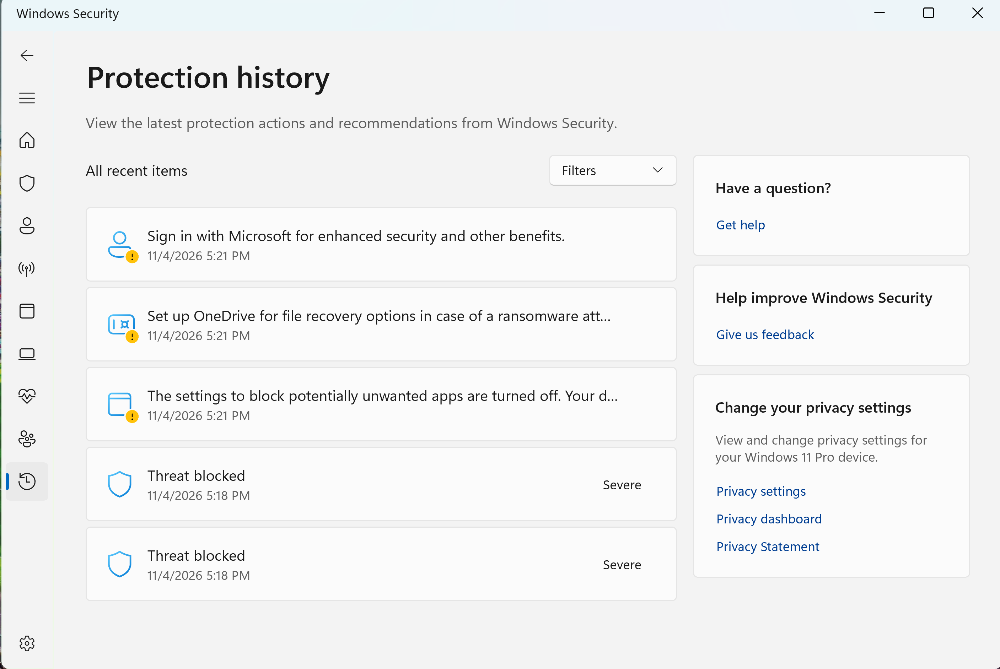
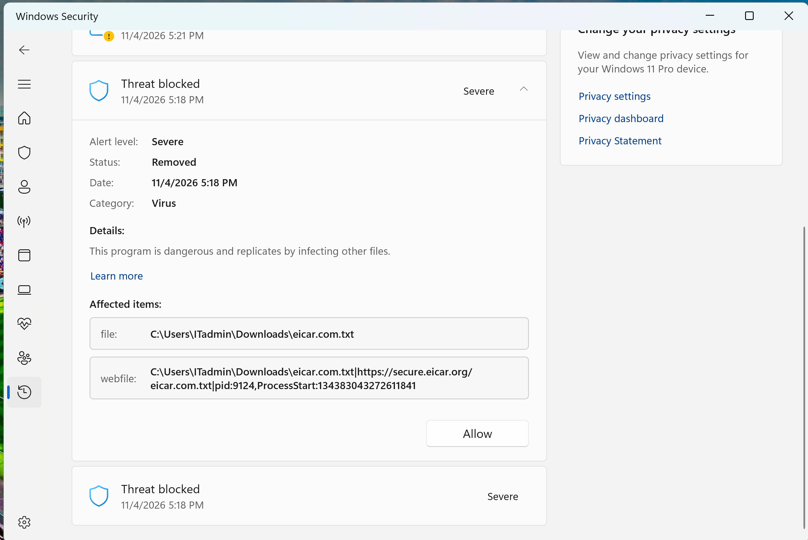
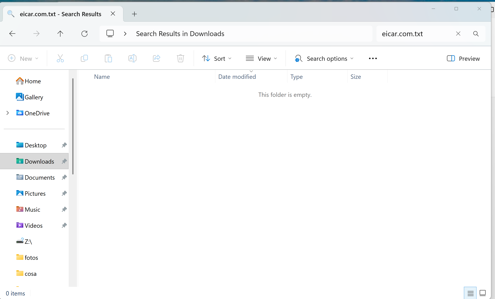
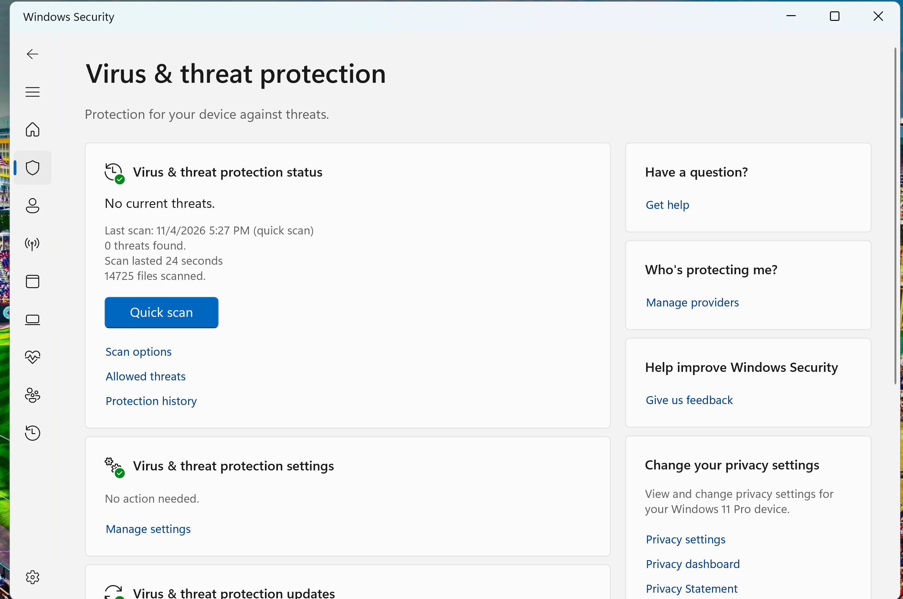

# Ticket #2001 — Microsoft Defender Security Incident

**Company:** TechNova (Simulated IT Environment)  
**Department:** IT Support / Security Administration  
**Device:** PC01 — Windows 11 Pro  
**Priority:** High (Simulated)  
**Status:** Resolved  
**Date:** November 4, 2026

---

## 1. Incident Overview

A simulated security incident was conducted on PC01 to evaluate Microsoft Defender Antivirus detection, prevention, and remediation capabilities.

The EICAR Anti-Malware Test File was used to safely simulate a malware detection without introducing actual malicious software.

## 2. Lab Environment

- Windows 11 Pro (PC01)
- VMware Workstation
- Microsoft Defender Antivirus
- Microsoft Edge
- EICAR Anti-Malware Test File
- Windows Security — Protection History

## 3. Troubleshooting and Investigation

### Step 1 — Initial Security Assessment

Verified that Real-time Protection and Cloud-delivered Protection were enabled.

Performed an initial Quick Scan to establish a security baseline.

### Step 2 — Simulated Threat Detection

Attempted to download the official EICAR test file using Microsoft Edge.

The download was blocked with the message:

**Couldn't download — Virus detected**

Windows Security also displayed a threat detection notification.

### Step 3 — Protection History Investigation

Opened Windows Security and reviewed Protection History.

The system recorded two blocked-threat events with a Severe alert level.

### Step 4 — Threat Remediation

Reviewed the detection details:

- **Alert Level:** Severe
- **Category:** Virus
- **Status:** Removed
- **Affected File:** `C:\Users\ITadmin\Downloads\eicar.com.txt`

Microsoft Defender automatically removed the detected test file.

No security exclusions or threat allowances were configured.

### Step 5 — File Removal Verification

Searched the Downloads directory for `eicar.com.txt`.

The file was no longer present.

### Step 6 — Final Security Verification

Performed a second Microsoft Defender Quick Scan after remediation.

**Final Scan Results:**

- Scan Type: Quick Scan
- Files Scanned: 14,725
- Scan Duration: 24 seconds
- Threats Found: 0
- Result: No current threats

## 4. Resolution

Microsoft Defender successfully detected and blocked the EICAR test file, recorded the security event, and removed the detected file.

A subsequent Quick Scan reported no current threats.

**Ticket Status: Resolved**

## 5. Skills Demonstrated

- Microsoft Defender Antivirus Administration
- Endpoint Security Monitoring
- Threat Detection and Response
- Windows Security Protection History Analysis
- Security Incident Troubleshooting
- Endpoint Remediation Verification
- Technical Documentation

## 6. Key Takeaways

This laboratory demonstrated how an IT Support technician can investigate antivirus alerts, verify automated remediation, and document a simulated endpoint security incident.

**Note:** EICAR is a harmless antivirus test file. This exercise does not represent a real malware infection. A clean Quick Scan does not guarantee the absence of all threats.

---

**TechNova IT Labs — Windows Security Administration Portfolio**
