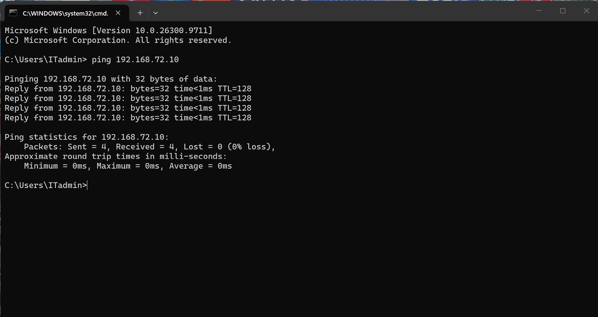
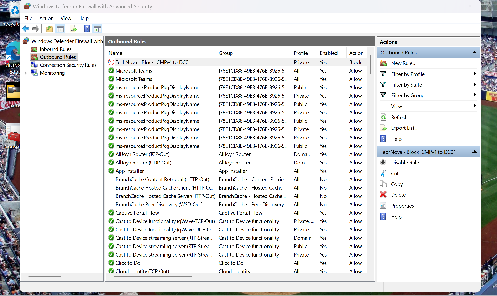
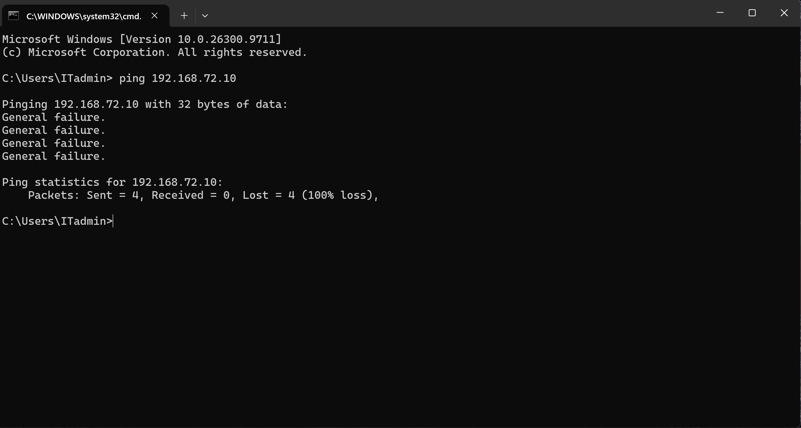

# Ticket #2002 — Windows Firewall Administration & Troubleshooting

**Company:** TechNova (Simulated IT Environment)  
**Department:** IT Support / Security Administration  
**Priority:** Medium (Simulated)  
**Status:** Resolved  
**Date:** November 4, 2026

---

## 1. Incident Overview

TechNova's IT department conducted a simulated network security troubleshooting exercise to evaluate Windows Defender Firewall configuration and traffic filtering.

The objective was to create and test inbound and outbound firewall rules, restrict ICMPv4 communication between two virtual machines, verify that SMB connectivity remained available, and restore network communication after testing.

## 2. Lab Environment

- **PC01:** Windows 11 Pro
- **DC01:** Windows Server 2022
- **Virtualization:** VMware Workstation
- **Network:** VMware NAT
- **DC01 IP Address:** 192.168.72.10
- **Firewall Management:** Windows Defender Firewall with Advanced Security (`wf.msc`)
- **Tools:** Command Prompt, PowerShell, `ping`, `Test-NetConnection`

## 3. Troubleshooting and Configuration

### Step 1 — Initial Network Connectivity

Executed a ping test from PC01 to DC01 to establish baseline connectivity.

**Result:**
- Packets sent: 4
- Packets received: 4
- Packet loss: 0%

### Step 2 — Outbound Firewall Rule Configuration

Created a custom outbound firewall rule on PC01.

**Rule Configuration:**
- Name: TechNova - Block ICMPv4 to DC01
- Direction: Outbound
- Protocol: ICMPv4
- ICMP Type: Echo Request
- Remote IP: 192.168.72.10
- Profile: Private
- Action: Block the connection

### Step 3 — Outbound Rule Verification

Executed another ping test from PC01 to DC01 after enabling the outbound rule.

**Result:**
- Packets sent: 4
- Packets received: 0
- Packet loss: 100%

The test demonstrated that outbound ICMPv4 Echo Requests were blocked.

### Step 4 — SMB Connectivity Verification

Verified
