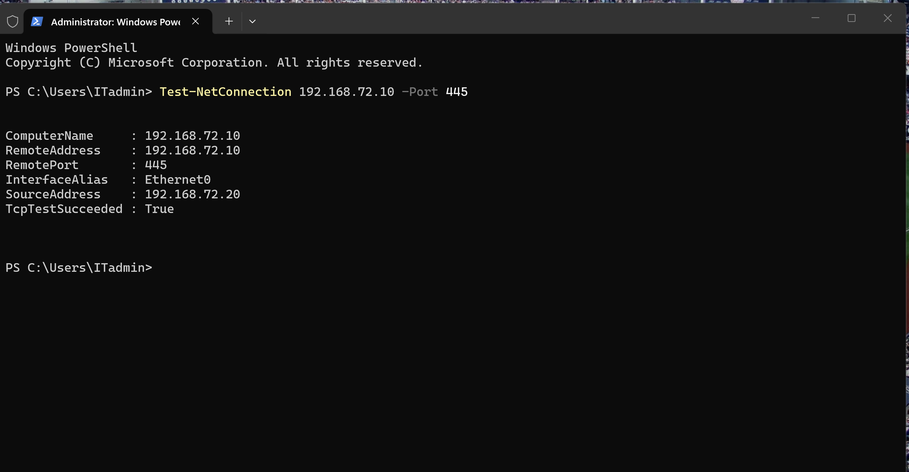
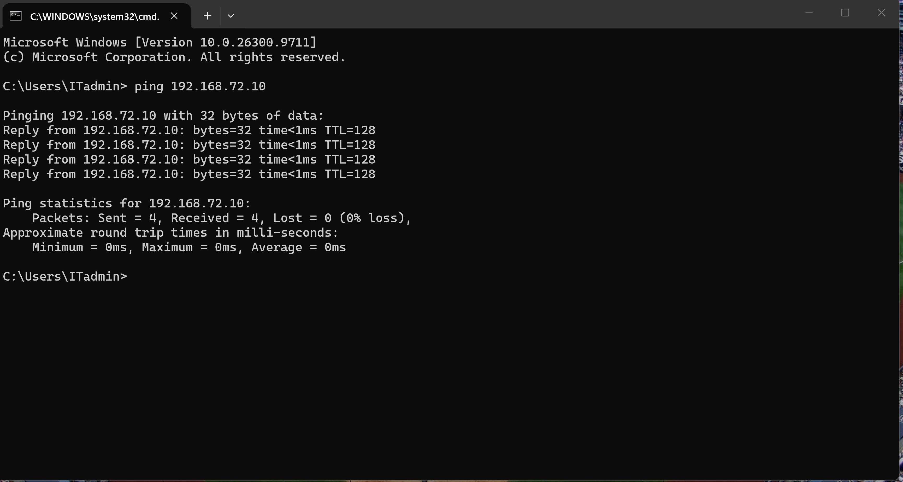
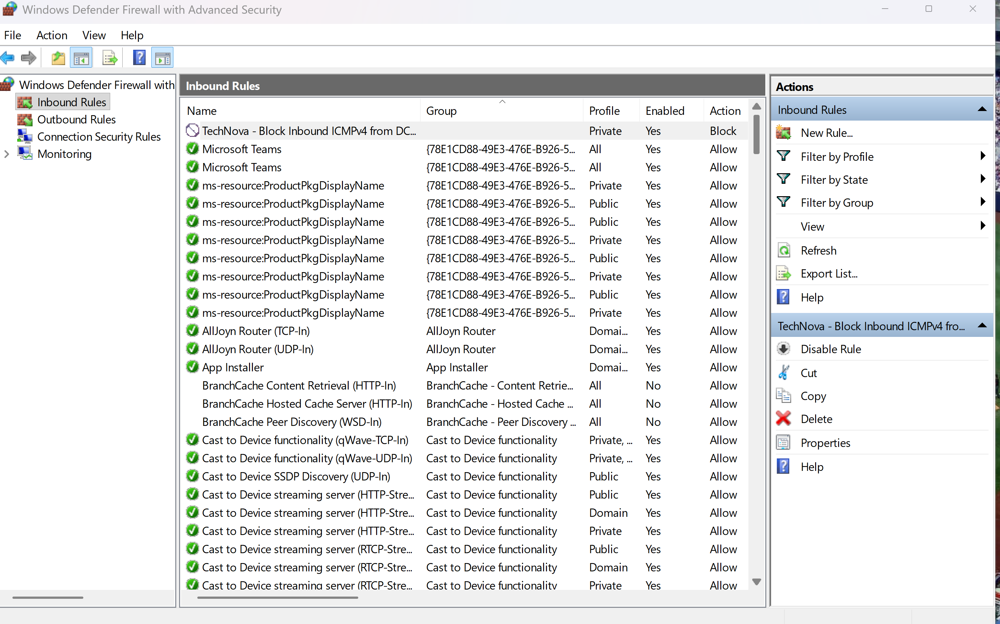
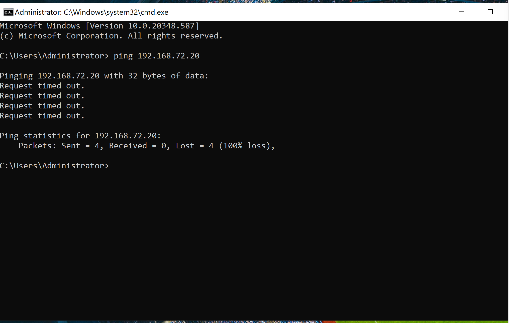
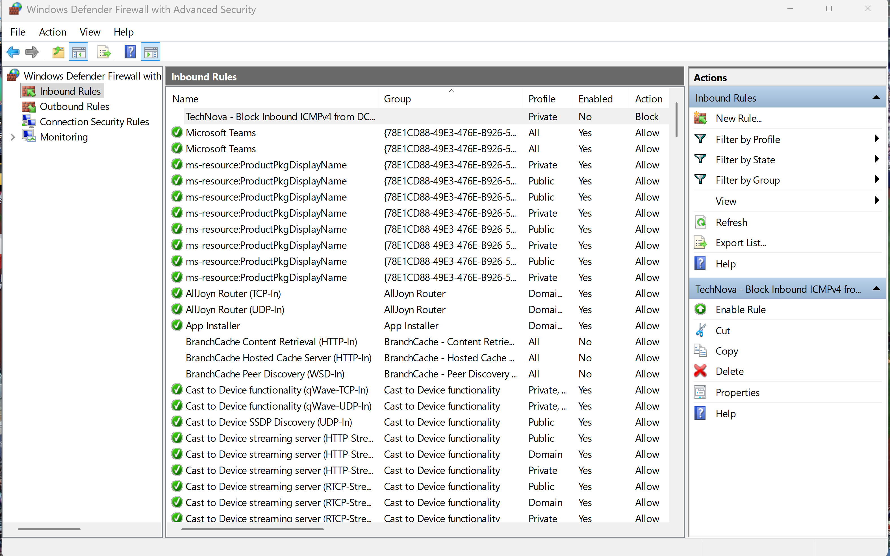

# Ticket #2002 — Windows Firewall Administration & Troubleshooting

**Company:** TechNova (Simulated IT Environment)  
**Department:** IT Support / Security Administration  
**Priority:** Medium (Simulated)  
**Status:** Resolved  
**Date:** November 4, 2026

---

## 1. Incident Overview

TechNova's IT department conducted a simulated firewall administration and network troubleshooting exercise.

The objective was to configure inbound and outbound firewall rules, restrict ICMPv4 traffic between two virtual machines, verify SMB connectivity, and restore network communication.

## 2. Lab Environment

- **PC01:** Windows 11 Pro
- **DC01:** Windows Server 2022
- **Virtualization:** VMware Workstation
- **Network:** VMware NAT
- **DC01 IP:** 192.168.72.10
- **Firewall Tool:** Windows Defender Firewall with Advanced Security (`wf.msc`)
- **Diagnostic Tools:** CMD, PowerShell, ping, Test-NetConnection

## 3. Troubleshooting and Configuration

### Step 1 — Initial Network Connectivity

Executed a ping test from PC01 to DC01.

**Results:**
- Packets sent: 4
- Packets received: 4
- Packet loss: 0%


### Step 2 — Outbound Firewall Rule Configuration

Created a custom outbound rule on PC01.

**Configuration:**
- Rule: TechNova - Block ICMPv4 to DC01
- Direction: Outbound
- Protocol: ICMPv4
- ICMP Type: Echo Request
- Remote IP: 192.168.72.10
- Profile: Private
- Action: Block


### Step 3 — Outbound Rule Verification

Executed another ping test from PC01 to DC01.

**Results:**
- Packets sent: 4
- Packets received: 0
- Packet loss: 100%

The firewall rule successfully blocked outbound ICMPv4 Echo Requests.


### Step 4 — SMB Connectivity Verification

Verified TCP connectivity to the SMB service on DC01.

**PowerShell Command:**

```powershell
Test-NetConnection 192.168.72.10 -Port 445
```

**Result:** `TcpTestSucceeded : True`

TCP port 445 remained reachable despite the ICMPv4 restriction.



### Step 5 — Outbound Connectivity Restoration

Disabled the outbound firewall rule and repeated the ping test.

**Results:**
- Packets sent: 4
- Packets received: 4
- Packet loss: 0%

Connectivity was successfully restored.



### Step 6 — Inbound Firewall Rule Configuration

Created a custom inbound firewall rule on PC01.

**Configuration:**
- Rule: TechNova - Block Inbound ICMPv4 from DC01
- Direction: Inbound
- Protocol: ICMPv4
- ICMP Type: Echo Request
- Remote IP: 192.168.72.10
- Profile: Private
- Action: Block



### Step 7 — Inbound Rule Verification

Executed a ping test from DC01 to PC01 while the inbound firewall rule was enabled.

**Results:**
- Packets sent: 4
- Packets received: 0
- Packet loss: 100%

The test confirmed that the inbound rule prevented ICMPv4 Echo Requests from reaching PC01 successfully.

### Step 8 — Inbound Connectivity Restoration

Disabled the inbound firewall rule and repeated the ping test from DC01.

**Results:**
- Packets sent: 4
- Packets received: 4
- Packet loss: 0%

The test confirmed that connectivity was restored after disabling the rule.



### Step 9 — Final Firewall Verification

Verified that both custom firewall rules were saved but disabled.

The simulated restrictions were removed without deleting the rules.



## 4. Resolution

Successfully configured and tested custom inbound and outbound ICMPv4 firewall rules.

Verified that TCP port 445 remained reachable while outbound ICMPv4 Echo Requests were blocked.

Restored connectivity by disabling both custom firewall rules.

**Final Status: Resolved**

## 5. Skills Demonstrated

- Windows Defender Firewall Administration
- Inbound and Outbound Rules
- ICMPv4 Traffic Filtering
- Network Connectivity Troubleshooting
- TCP Port Testing
- PowerShell Network Diagnostics
- Firewall Rule Management
- Technical Documentation

## 6. Key Takeaways

This laboratory demonstrated how an IT Support technician can configure targeted firewall restrictions, investigate network connectivity issues, and restore communication without disabling the entire Windows Firewall.

---

**TechNova IT Labs — Windows Security Administration Portfolio**

