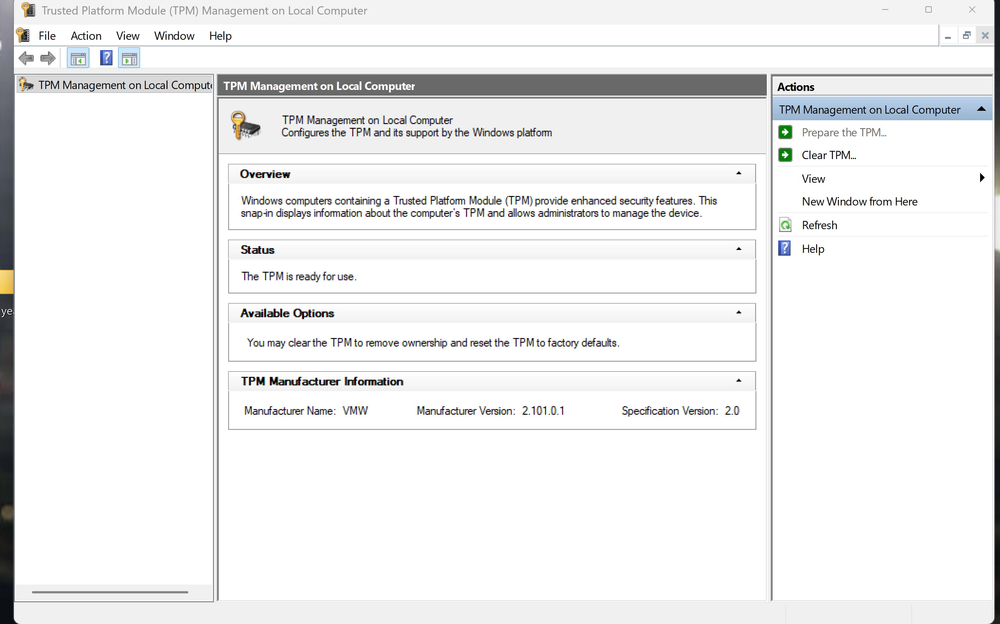
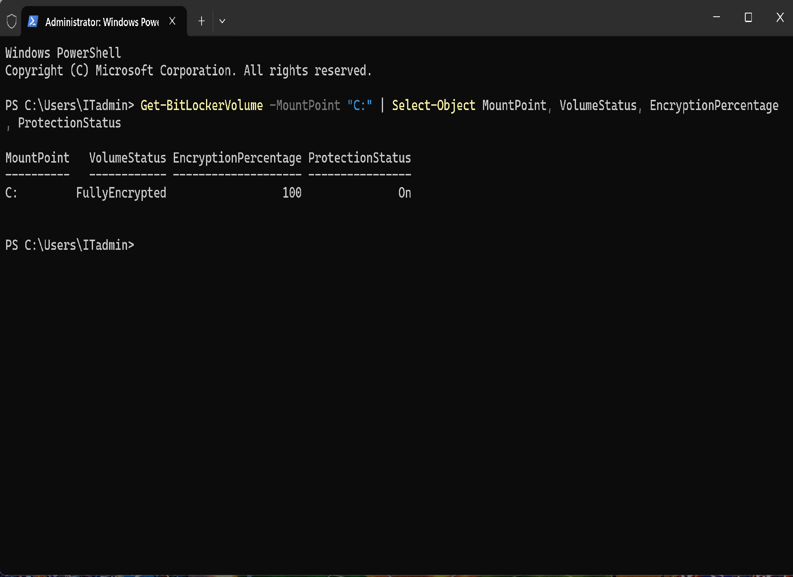
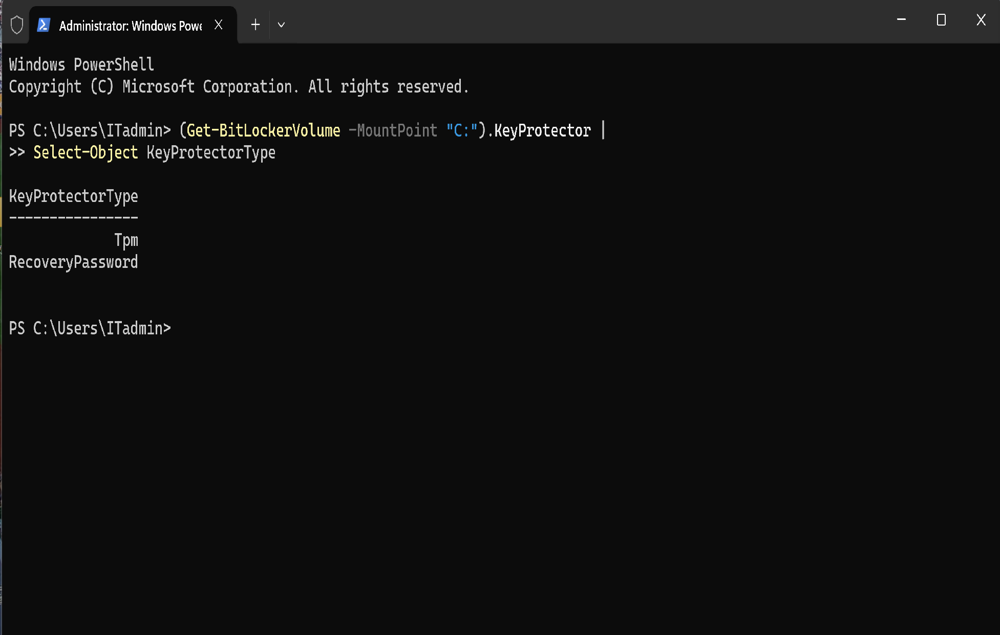

# Ticket #2003 — BitLocker Drive Encryption & Recovery

**Company:** TechNova (Simulated IT Environment)  
**Department:** IT Support / Security Administration  
**Priority:** Medium (Simulated)  
**Status:** Encryption Completed — Stability Monitoring  
**Date:** November 4, 2026

---

## 1. Incident Overview

TechNova's IT department conducted a simulated endpoint security exercise to configure BitLocker Drive Encryption on a Windows 11 Pro virtual machine.

The objective was to enable full-volume encryption, verify TPM 2.0 compatibility, securely back up the recovery key, validate BitLocker protection using PowerShell, and confirm successful system startup without external recovery media.

## 2. Lab Environment

- **Computer:** PC01 — Windows 11 Pro
- **Virtualization:** VMware Workstation
- **Security Technology:** BitLocker Drive Encryption
- **TPM:** VMware Virtual TPM 2.0
- **Encrypted Volume:** C:
- **Recovery Key Backup:** External USB drive
- **Administration Tools:** Control Panel, TPM Management, PowerShell

## 3. Configuration and Verification

### Step 1 — TPM 2.0 Verification

Opened TPM Management (`tpm.msc`) to verify the availability and operational status of the virtual Trusted Platform Module.

**Result:**
- TPM status: Ready for use
- TPM specification version: 2.0
- Manufacturer: VMware

### Step 2 — BitLocker Configuration

Enabled BitLocker Drive Encryption on the operating system volume (C:).

Configuration included:

- Backing up the recovery password to external USB storage.
- Selecting used disk space encryption.
- Selecting the new encryption mode (XTS-AES).
- Running the BitLocker system check.
- Restarting Windows to validate the configuration.

The encryption process completed successfully.

### Step 3 — Encryption Status Verification

Executed the following PowerShell command:

`Get-BitLockerVolume -MountPoint "C:" | Select-Object MountPoint, VolumeStatus, EncryptionPercentage, ProtectionStatus`

**Results:**
- VolumeStatus: FullyEncrypted
- EncryptionPercentage: 100
- ProtectionStatus: On

### Step 4 — Key Protector Verification

Executed the following PowerShell command:

`(Get-BitLockerVolume -MountPoint "C:").KeyProtector | Select-Object KeyProtectorType`

**Results:**
- Tpm
- RecoveryPassword

### Step 5 — System Startup Validation

Disconnected the external USB drive containing the recovery key and restarted PC01.

Windows 11 successfully booted without requesting the recovery password.

This verified normal TPM-based startup protection.

## 4. Troubleshooting Notes

During the encryption exercise, PC01 experienced unexpected Windows restarts associated with a `0x124` bug check.

Windows Reliability Monitor was used to investigate the failures.

The system subsequently operated normally after the USB device was disconnected from the virtual machine.

**Root cause:** Not conclusively determined. USB device passthrough or virtualization-related behavior remains a possible contributing factor.

No additional BlueScreen events were observed during the final verification period.

## 5. Final Results

- TPM 2.0 verified successfully.
- BitLocker encryption completed at 100%.
- Protection status confirmed as enabled.
- TPM and recovery password protectors verified.
- Recovery key backed up to external USB storage.
- Windows booted successfully without external recovery media.
- System stability monitoring recommended due to the earlier unexpected restarts.

## 6. Skills Demonstrated

- Windows 11 Security Administration
- BitLocker Drive Encryption
- TPM 2.0 Management
- Recovery Key Management
- PowerShell Security Verification
- Windows Reliability Monitor
- Endpoint Security Troubleshooting
- VMware Virtual Machine Administration

---

**Lab completed by:** Wily-IT-Labs  
**Project:** TechNova IT Labs — Windows Security Administration
