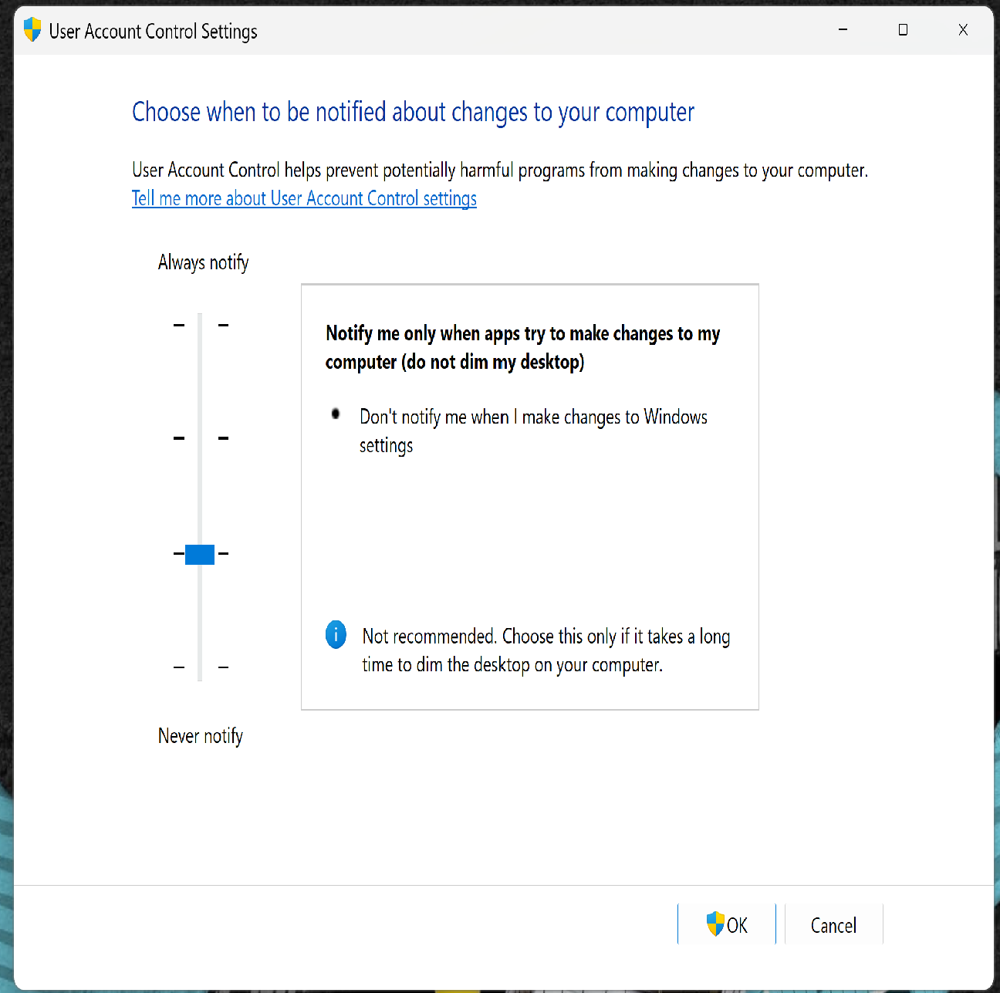
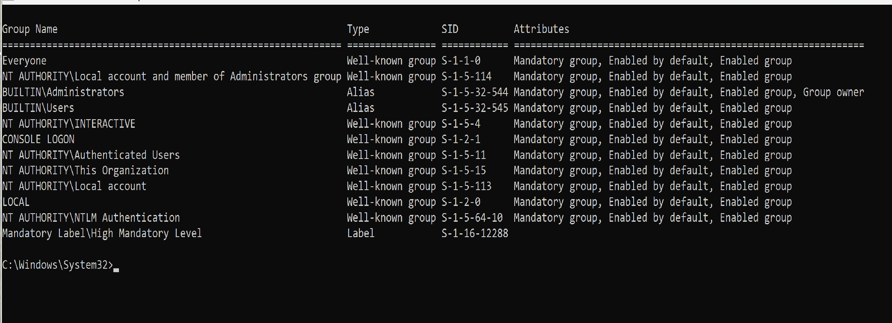
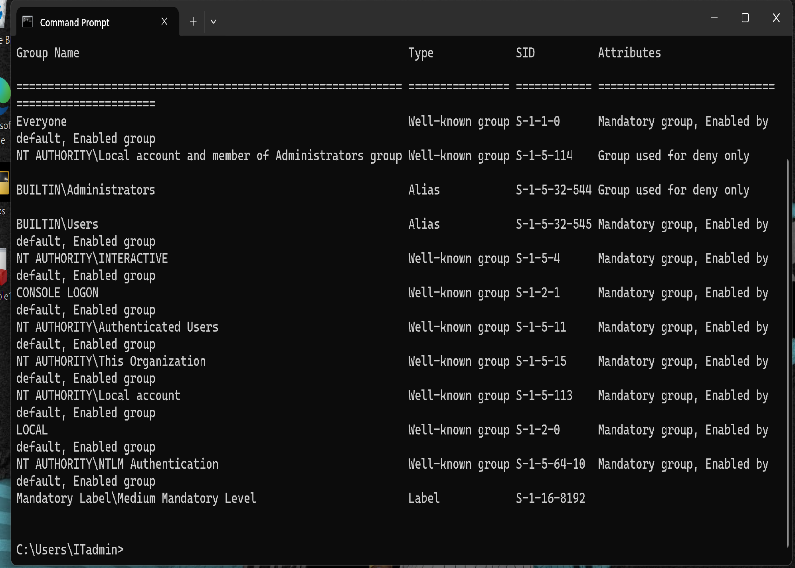
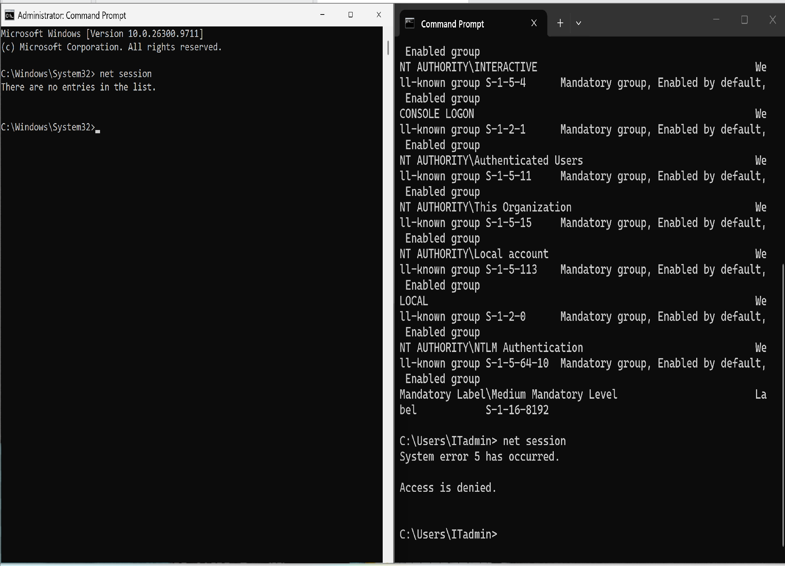
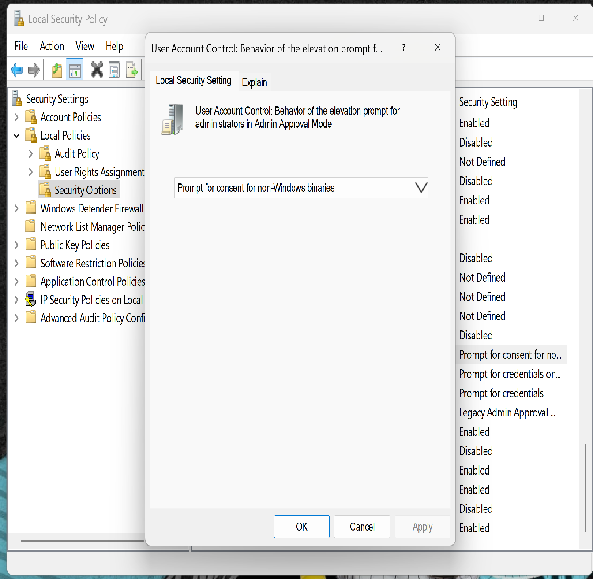
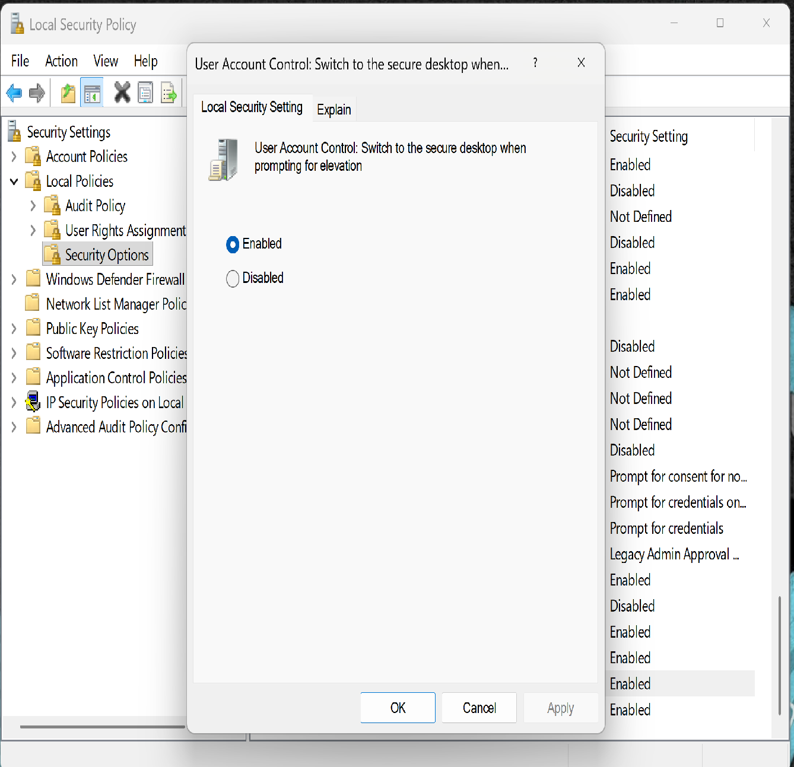

# TechNova IT Support — Ticket #2004
## User Account Control (UAC) Administration & Troubleshooting

**Environment:** Windows 11 Pro (PC01)  
**Role:** IT Support Specialist  
**Category:** Windows Security Administration  
**Status:** Resolved

---

### 1. Business Scenario

TechNova's IT department was tasked with reviewing User Account Control (UAC) settings on a Windows 11 workstation.

The objective was to verify administrative privilege elevation, investigate access restrictions, and strengthen security by enabling Secure Desktop.

### 2. Lab Objectives

- Review and configure UAC notification levels.
- Verify administrative privilege elevation.
- Compare standard and elevated command prompts.
- Troubleshoot an Access Denied error.
- Review UAC security policies.
- Enable and validate Secure Desktop protection.

### 3. Tools Used

- Windows 11 Pro
- Command Prompt (CMD)
- Local Security Policy (`secpol.msc`)
- User Account Control Settings
- `whoami /groups`
- `net session`

### 4. Troubleshooting and Implementation

**Step 1 — UAC Configuration**

Reviewed the existing UAC configuration and selected the default notification level.

**Step 2 — Administrator Privilege Elevation**

Opened Command Prompt using "Run as administrator" and executed:

`whoami /groups`

Confirmed that the Administrators group was enabled and the process had a High Mandatory Level integrity label.

**Step 3 — Standard vs. Elevated CMD**

Opened a standard Command Prompt and executed:

`whoami /groups`

Verified that the Administrators group was marked "Group used for deny only" and the process had Medium Mandatory Level integrity.

**Step 4 — Access Denied Troubleshooting**

Executed `net session` in a non-elevated Command Prompt.

Result:

`System error 5 has occurred. Access is denied.`

Repeated the command in an elevated Command Prompt.

Result:

`There are no entries in the list.`

This demonstrated how administrative elevation affects access to protected operations.

**Step 5 — UAC Security Policy Review**

Opened Local Security Policy and verified:

- Run all administrators in Admin Approval Mode: Enabled
- Behavior of the elevation prompt for administrators: Prompt for consent for non-Windows binaries

**Step 6 — Secure Desktop Configuration**

Identified that the Secure Desktop policy was disabled.

Enabled:

`User Account Control: Switch to the secure desktop when prompting for elevation`

Verified that the screen dimmed when requesting administrator elevation.

### 5. Final Results

| Test | Result |
|---|---|
| UAC notification configuration | Passed |
| Administrator privilege elevation | Passed |
| Standard vs. elevated token comparison | Passed |
| Access Denied troubleshooting | Passed |
| Admin Approval Mode verification | Passed |
| Secure Desktop configuration | Passed |

### 6. Security Best Practices

- Keep UAC enabled on enterprise workstations.
- Use standard privileges for routine activities.
- Elevate permissions only when necessary.
- Enable Secure Desktop for elevation prompts.
- Follow the principle of least privilege.
- Document security configuration changes.

### 7. Conclusion

Successfully reviewed, tested, and strengthened User Account Control security on a Windows 11 Pro workstation.

Demonstrated practical Windows administration, privilege elevation troubleshooting, security policy management, and least-privilege principles in a simulated enterprise IT support environment.

**Ticket Status: Resolved**
